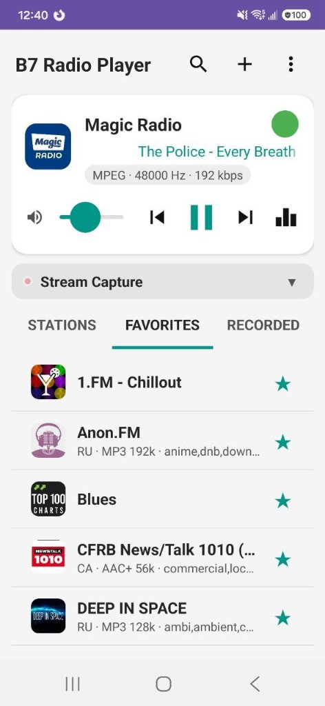
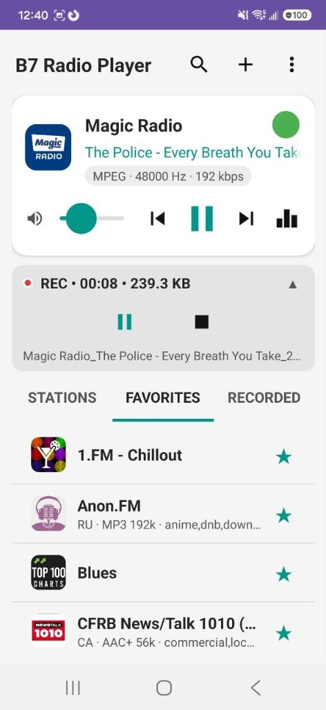
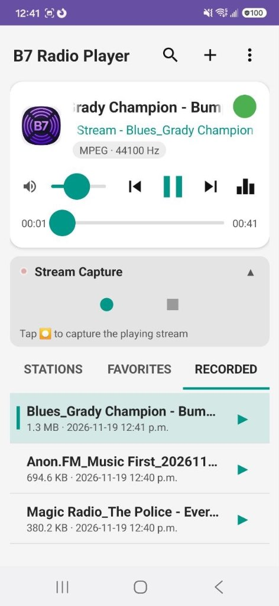

# B7 Radio Player

An open-source Android internet radio player built with AndroidX Media3.

## Screenshots
<p align="left">
  
  
  
</p>

## Features
- Stream live internet radio stations (MP3, AAC, OGG, M3U, PLS)
- Browse and search stations by name, country, and genre via Radio Browser
- Folding **Stream Capture** panel with Record / Pause / Stop controls
- Auto-split recordings on song change with automatic MP3 ID3v2.3 tags (Title, Artist, Station/Album)
- **Recorded** tab with in-app seekable replay and multi-select bulk delete
- Configurable capture folder in Settings (`Music`, `Downloads`, or custom folder)
- Custom **Controls & Highlights Color** presets and interactive HSV Color Wheel picker (plus Light/Dark/System theme)
- Built-in equalizer (Bass, Mid, Treble) and Sleep Timer
- Favorites, custom station management, and dead-station scanner
- Import and export station playlists (`XML` / `M3U` / `PLS`)
- Background playback with lock screen and Android Auto controls

## Build Instructions

### Command Line
```bash
./gradlew assembleRelease
```

### Android Studio
1. **File → Open** and select the `B7 Radio Player` folder.
2. Build with **Build → Make Project** or run directly on a device/emulator.

## Permissions
- `INTERNET` & `ACCESS_NETWORK_STATE`: Stream radio stations and search Radio Browser.
- `WAKE_LOCK`, `FOREGROUND_SERVICE`, `FOREGROUND_SERVICE_MEDIA_PLAYBACK`: Keep audio playing in the background.
- `MODIFY_AUDIO_SETTINGS`: Support the built-in equalizer.

## License
Licensed under the [GNU General Public License v3.0](LICENSE) (`GPL-3.0-or-later`).
